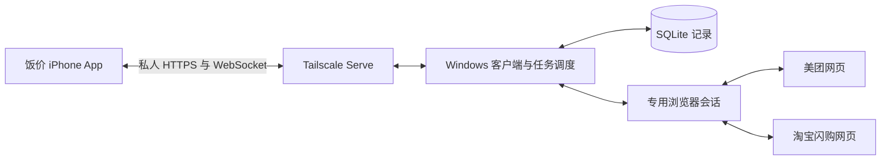

# 饭价：电脑后端与 iPhone 客户端方案

日期：2026-10-24（Asia/Shanghai）。状态：用户已确认执行方案 A，开始实施。

## 已确认的需求变更

- 由现有 Windows 电脑承担平台查询、规格选择、选券、凑单、比较与记录；电脑通常全天开机。
- 保留现有 SwiftUI“饭价”原生 App，用于选择、搜索、查看进度与结果。
- 同一 Wi-Fi 和外出手机流量均需使用。接受电脑与手机安装私人组网 App，并在查询时切换 iPhone VPN。
- 必须能在手机远程处理电脑浏览器中的登录与验证码，然后恢复查询。
- 仍为个人自用、所有新增服务费用为零；不租服务器、不调用收费模型。保留现有免费 iOS 构建与自签路线。
- 平台仍是美团与独立淘宝闪购 App 对应的网页入口；网页券后金额与目标 App 的一致性需继续实际核对。
- 真实报价包含本人可用红包、会员券、配送费和包装费。历史订单与买过的套餐用于缩小候选，每次重新取得结算金额。
- 必含商品、预算与允许的额外商品条件继续有效。汉堡王与牛约堡的阶段验证预算均为 30 元。
- 不提交订单或付款。创建 PR、合并 PR 仍分别由用户确认。

上述运行位置和前沿定义取代旧 decisions-food-compare.md 中“手机独立运行”和“价格/时间前沿”的要求；其余已确认约束延续。

## 前沿的精确定义

先按同一家具体门店、同一配送地址与可比报价时间范围分组，并过滤预算、必含商品和额外商品限制。

购物篮用“餐品身份 + 完整规格 + 数量”表示。套餐只有确认组成后才拆成具体餐品；无法确认的组合不推定包含另一组合。跨平台只有门店及餐品映射确认后才合并比较。

若 B 包含 A 的每项餐品及规格，数量均不少于 A，且 B 的最终应付价格不高于 A，那么在以下至少一项成立时淘汰 A：

1. B 的应付价格更低；
2. B 至少多一项餐品或某项数量更多。

同价且更多时只保留更多的一项。内容互不包含的方案均可保留；不折算总件数、克数、热量或主观权重。完全相同内容与价格的重复记录合并展示并保留来源。送达时间仅展示，不参与此支配判断。

例：鸡堡 + 薯条 28 元，被同规格鸡堡 + 薯条 + 饮料 26 元或 28 元支配；鸡堡 + 薯条与鸡堡 + 鸡块互不包含，不能仅按总件数相互淘汰。

## 方案 A：Electron 桌面客户端与 TypeScript 后端

- 技术栈：SwiftUI 手机端；Electron Windows 托盘客户端；Node.js LTS + TypeScript 服务与调度；Playwright 控制专用浏览器；SQLite 本地记录；Tailscale Serve 提供私人 HTTPS 入口；HTTPS 请求与 WebSocket 进度/接管通信。
- 为什么适合：现有页面适配与测试主要是 JavaScript，可以逐项迁移；电脑端调度与前沿计算使用同一语言。用户无需自行维护网站服务器或数据库服务。
- 开发难度 / 维护成本：中等。需要迁移原生调度逻辑、补齐结构化商品数据，并实现手机远程浏览器接管。后续主要维护平台页面适配及客户端依赖更新。
- 目标地区能否顺利使用：平台访问由中国大陆电脑直接发起。私人组网在用户家庭宽带与手机运营商网络的直连、转发速度尚待实测；不承诺未经测试的国内可用率。
- 你得自己管的东西：电脑联网、不休眠；Tailscale 账号及设备；按客户端提示登录和验证；安装更新及备份本地记录。手机配对凭据保存在 Keychain，电脑侧凭据使用系统保护；外卖会话保存在专用浏览器资料目录。
- 主要风险：安装包和浏览器占用较大；网页变化和平台验证仍可能中断查询；远程拖动验证的延迟、电脑锁屏后页面行为需先验证。iOS 原生 App 仍有免费签名续期工作。

## 方案 B：WPF 原生 Windows 客户端与 C# 后端

- 技术栈：SwiftUI 手机端；.NET / WPF Windows 客户端；ASP.NET Core 本地服务；Microsoft.Playwright；SQLite；与方案 A 相同的 Tailscale HTTPS / WebSocket 通信。
- 为什么适合：只面向 Windows，桌面窗口与系统集成使用微软原生技术；Playwright 也有官方 .NET 支持，现有 DOM 脚本仍可在浏览器执行。
- 开发难度 / 维护成本：中等偏高。除 Swift 和 JavaScript 外增加 C#，调度、数据模型、测试需要适配更多语言。
- 目标地区能否顺利使用：与方案 A 相同，网络链路必须在实际宽带与手机流量下验证。
- 你得自己管的东西：与方案 A 相同；发布时打包运行环境，避免要求用户手工管理开发工具。
- 主要风险：迁移工作更多，且不会因此改善平台登录、券覆盖或结算页面可靠性；依然需要维护浏览器与网页适配。

推荐：方案 A。决定性理由是它与现有 JavaScript 适配代码和已调研项目衔接更直接，能把维护集中在 Swift 手机界面与 TypeScript 电脑后端两侧。

## 网络与费用依据

截至查询日，Tailscale Personal 官方定价为 0 美元，最多 6 名用户，足够此个人双设备场景。Serve 可以代理本机服务并自动配置 HTTPS 证书。这里使用私人网络入口，不把服务发布到公开互联网。

- [Tailscale 定价](https://tailscale.com/pricing)
- [Tailscale Serve](https://tailscale.com/docs/reference/tailscale-cli/serve)
- [iOS 与其他 VPN 的兼容限制](https://tailscale.com/docs/reference/faq/other-vpns)

普通公网 HTTPS 隧道仅作为私人组网实际测试不合格后的备选。Cloudflare 的固定公开应用入口要求域名；临时 Quick Tunnel 的地址会变化且无在线保障，官方定位为测试用途，所以不将临时隧道作为长期主链路。是否已有合适域名尚未确认，不为此增加域名购买费用。

- [Cloudflare 正式隧道前提](https://developers.cloudflare.com/tunnel/get-started/)
- [Quick Tunnel 的用途与限制](https://developers.cloudflare.com/tunnel/get-started/quick-tunnels/)

## 推荐方案的职责与通信

- 手机提交搜索条件，电脑返回任务编号；进度连接断开不重复创建任务。重新打开 App 后按任务编号取回状态和结果。
- 电脑按平台串行修改购物车，避免两个任务互相覆盖。手机切到后台后电脑继续工作；不依赖 iOS 持续后台联网。
- SQLite 保存门店索引、已确认餐品与套餐组成、候选购物篮、报价时间、券后金额、优惠摘要和任务状态。历史报价明确标为历史，不充当实时结果。
- 初次由电脑显示配对入口，手机扫码取得连接信息并完成设备配对；后续请求需持有配对凭据。
- 自动化遇登录或验证码后暂停。手机显示同一浏览器会话的画面，将用户的点击、拖动、输入传给电脑；用户结束接管后重新检查页面和购物车，再继续查询。
- 远程接管基于 Playwright 的页面画面和输入能力实现；网络通道只接受限定的页面输入操作。平台网页与有本机权限的桌面管理界面隔离。
- 电脑离线时手机显示最后记录与采集时间。电脑重启中断的购物车任务先检查现场状态，不盲目重放加购。

## 现有代码的迁移边界

- Probe.js、Shopping.js、Coupon.js、History.js 是页面脚本，可作为 Playwright 适配的起点；页面在桌面浏览器中的渲染仍需重新验证。
- PlatformSession.swift 和 ShoppingAutomation.swift 中的浏览器调度迁到电脑；手机保留表单、结果展示，新增连接状态和人工接管界面。
- 当前 ShoppingQuote 主要记录购物篮描述，必须增加真实的门店、地址上下文、SKU、完整规格及数量；最终前沿必须基于结算时核对的实际购物篮。
- 现有两处价格/时间筛选统一替换为上文的包含关系筛选，避免后台与手机分别算出不同结果。
- 当前淘宝闪购部分菜单价格、复杂规格和历史订单读取仍不完整，不能把“搬到电脑”当作这些能力已解决。
- GitHub 类似项目只作为经过核对的参考：优先复用适配思路与明确许可的代码，个人券后金额仍通过实际结算验证。

## 确认后的实施顺序与验收

1. 通信与人工接管验证：Windows 客户端启动；手机通过家庭 Wi-Fi 和手机流量分别连接；显示同一浏览器会话；手动登录/验证后可恢复任务；检查锁屏和断线重连行为。
2. 单店取数与记录：补齐汉堡王目标套餐组成、规格、数量及实时券后金额；查询任务和记录落盘，重启可读取历史。
3. 配餐与前沿：加入有限候选的选券、凑单试价；以牛约堡复杂套餐验证包含关系、预算和同价多餐淘汰。未知组成不伪造匹配。
4. 扩展自动搜索与历史索引：在已确认单店链路基础上实现自动入店和更多历史套餐候选。

优先验收条件：手机流量可稳定连接；手机人工验证确实作用于电脑同一会话；完成后的报价与实际结算一致。若任一项失败，先记录具体阻塞点再调整方案，不扩展商家覆盖掩盖基础问题。

暂未确定：Tailscale 在用户实际网络的连通性和人工接管体验；电脑浏览器是否能获得目标入口的完整优惠。它们是实际验证事项，无需用户提前猜测。

仍会改变推荐的待定问题：若私人组网实际不可用，需要重新选择网络链路；若电脑网页缺少目标 App 优惠，需要重新评估平台接入方式。当前没有尚待回答、会改变 A/B 技术选择的偏好问题。

## 技术依据

- [Playwright 浏览器支持](https://playwright.dev/docs/browsers)
- [持久浏览器会话](https://playwright.dev/docs/api/class-browsertype#browser-type-launch-persistent-context)
- [Electron 外部网页与本机权限隔离](https://www.electronjs.org/docs/latest/tutorial/security)
- [WPF 官方概述](https://learn.microsoft.com/en-us/dotnet/desktop/wpf/overview/)
- [Playwright .NET](https://playwright.dev/dotnet/docs/intro)
